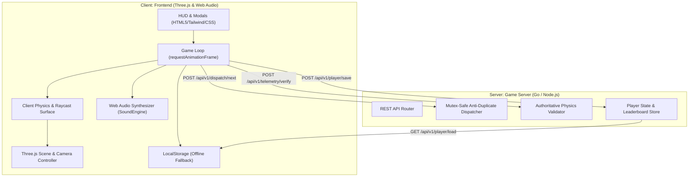

# Arsitektur Sistem: Warehouse Express 3D (Connected City)

Dokumen ini menjelaskan struktur arsitektur sistem game **Warehouse Express 3D**, pemisahan tanggung jawab (*separation of concerns*) antara Frontend (Client) dan Backend (Server), alur logika pengiriman, serta sistem fisika permukaan.

---

## 1. Diagram Arsitektur Tingkat Tinggi

---

## 2. Pemisahan Tanggung Jawab (FE vs BE)

### A. Frontend (`frontend/`)
1. **Rendering & Grafis 3D**:
   - Three.js WebGL Renderer (Shadow map, Soft Shadows, Antialias).
   - Dynamic Lighting (Directional Sun Light dengan dynamic shadows + Ambient Fill Light).
   - Procedural Meshes: Blok aspal kota, bukit dataran tinggi (Plateau 3.6m), tanjakan penghubung (Ramps), pohon, gedung-gedung, dan warehouse gudang.
2. **Audio Sintetis**:
   - Web Audio API `OscillatorNode` + `BiquadFilterNode` + `GainNode` untuk mensimulasikan deru mesin kendaraan tanpa memuat file audio statis eksternal (.mp3/.wav).
   - Efek suara prosedural untuk klakson, tubrukan, koin, dan keberhasilan drop-off.
3. **Kontrol Pemain & HUD**:
   - Keyboard: `WASD` / `Arrow Keys` + `Space` (Brake/Interaksi) + `R` (Flip/Reset) + `ESC` (Pause).
   - Virtual Touch Joystick & Action Button untuk perangkat layar sentuh / mobile.
   - Glassmorphism HUD: Speedometer, indikator muatan (Cargo Stack), timer per paket, dan minimap level track.

### B. Backend (`backend/`)
1. **Mutex-Safe Anti-Duplicate Dispatcher**:
   - Mengambil kumpulan ID rumah penerima pada level aktif.
   - Memastikan rumah yang baru saja menerima paket tidak akan terpilih kembali secara berturut-turut ($Target_{n} \neq Target_{n-1}$).
   - Thread-safe concurrency dengan mutex lock untuk menangani ribuan sesi game secara bersamaan.
2. **Authoritative Physics & Anti-Cheat Validation**:
   - Memvalidasi perpindahan koordinat kendaraan pemain:
     $$\Delta dist = \sqrt{(X_{next} - X_{prev})^2 + (Z_{next} - Z_{prev})^2}$$
   - Memverifikasi apakah $\Delta dist \le MaxSpeed(Surface) \times \frac{\Delta t}{16.67ms} \times Tolerance$.
   - Mencegah manipulasi DOM atau modifikasi memori sisi klien (teleport hack atau speed hack).
3. **Persistensi State Pemain & Katalog Kendaraan**:
   - Menyimpan saldo gaji (`totalSalary`), progres level tertinggi, riwayat armada yang dimiliki (`purchasedVehicles`), dan kendaraan aktif (`equippedVehicle`).
   - Papan peringkat terpadu (Global Leaderboard).

---

## 3. Sistem Fisika & Koefisien Permukaan Jalan

Game ini mengimplementasikan deteksi permukaan secara real-time berdasarkan koordinat $(X, Z)$ kendaraan pemain:

| Tipe Permukaan | Multiplier Kecepatan | Max Base Speed | Efek Fisika / Karakteristik |
| :--- | :--- | :--- | :--- |
| **Asphalt (Aspal)** | $100\%$ | $0.56$ | Traksi penuh, akselerasi optimal |
| **Concrete (Beton)** | $80\%$ | $0.45$ | Sedikit hambatan gelinding |
| **Dirt (Tanah/Jalan Pintas)** | $60\%$ | $0.34$ | Licin, akselerasi lebih lambat |
| **Grass (Rumput/Taman)** | $35\%$ | $0.20$ | Hambatan berat, kecepatan drop drastis |

---

## 4. Sistem Elevasi & Tanjakan 3D (Hill Plateau & Ramps)

Untuk memberikan nuansa kota 3D yang dinamis, kota memiliki distrik bukit (*Plateau*) dengan ketinggian $Y = 3.6\,\text{meter}$:
- **Ground Level**: $Y = 0.0\,\text{m}$ (Area gudang logistik dan distrik bawah).
- **Plateau Level**: $Y = 3.6\,\text{m}$ (Area perumahan dataran tinggi).
- **Ramp Slopes**: Permukaan miring dengan interpolasi linier $Y = Y_0 + (Y_1 - Y_0) \times t$ untuk transisi mulus kendaraan saat menaiki dan menuruni bukit.

---

## 5. Topologi & Pipeline Deployment

Sistem dirancang untuk mendukung deployment modular:
1. **Containerized Production**:
   - `frontend/Dockerfile`: Image Nginx Alpine (<25 MB) dengan Gzip compression dan reverse proxy `/api/`.
   - `backend/Dockerfile`: Multi-stage build Golang (<15 MB) dengan non-root user `appuser` dan automated healthcheck.
   - `docker-compose.yml`: Menghubungkan client dan server dalam satu virtual network bridge terisolasi.
2. **Serverless Static Edge**:
   - `vercel.json` & `netlify.toml` untuk deployment instan frontend ke global edge CDN.
3. **CI/CD Pipeline**:
   - `.github/workflows/ci.yml` memvalidasi integritas aset frontend dan build Go/Node.js pada setiap pull request dan merge ke `main`.

