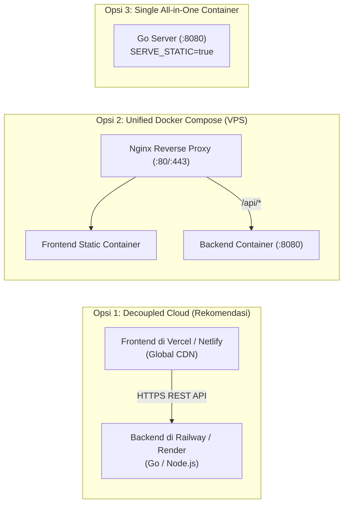

# Panduan Deployment Produksi (Warehouse Express 3D)

Dokumen ini menjelaskan tata cara mendistribusikan (*deployment*) game **Warehouse Express 3D** ke lingkungan produksi menggunakan berbagai strategi arsitektur modern.

---

## 🏗️ 3 Pilihan Strategi Deployment



---

## 🚀 Opsi 1: Decoupled Cloud Deployment (Vercel + Railway / Render)

Strategi paling efisien, hemat biaya (tersedia tier gratis), dan memiliki latensi minimal untuk pengguna global.

### A. Deploy Frontend ke Vercel
1. Hubungkan repositori GitHub Anda ke [Vercel](https://vercel.com).
2. Konfigurasi proyek di dashboard Vercel:
   - **Framework Preset**: *Other*
   - **Root Directory**: `./` (atau pilih folder `frontend`)
   - File [vercel.json](file:///c:/Fauzi/kurir-paket/vercel.json) di root akan otomatis menangani routing statis Three.js.
3. Klik **Deploy**. Vercel akan menghasilkan domain produksi, misal: `https://kurir-paket.vercel.app`.

### B. Deploy Backend ke Railway / Render
1. Buat proyek baru di [Railway](https://railway.app) atau [Render](https://render.com).
2. Pilih opsi **Deploy from GitHub repo**, lalu atur:
   - **Root Directory**: `backend`
   - **Build Command (Go)**: `go build -o server cmd/server/main.go`
   - **Start Command (Go)**: `./server`
   - *(Atau jika memilih Node.js: `node server.js`)*
3. Tambahkan Environment Variable di dashboard:
   - `PORT`: `8080` (atau port dinamis dari platform)
   - `ENVIRONMENT`: `production`
   - `CORS_ALLOWED_ORIGINS`: `https://kurir-paket.vercel.app` *(Domain Vercel Anda)*
4. Salin URL publik backend yang dihasilkan, misal: `https://kurir-api.railway.app`.

### C. Menghubungkan Frontend ke Backend
Atur file [frontend/js/config.js](file:///c:/Fauzi/kurir-paket/frontend/js/config.js) atau inject melalui script tag sebelum `config.js`:
```html
<script>
  window.__ENV__ = {
    API_BASE_URL: "https://kurir-api.railway.app"
  };
</script>
<script src="js/config.js"></script>
```

---

## 🐳 Opsi 2: Fullstack Docker Compose (VPS DigitalOcean / AWS / Linode)

Gunakan strategi ini jika Anda memiliki server VPS Ubuntu/Debian sendiri.

### Prasyarat di VPS:
- Docker Engine & Docker Compose terpasang:
  ```bash
  sudo apt update && sudo apt install -y docker.io docker-compose
  ```

### Langkah Menjalankan:
1. Clone repositori ke VPS:
   ```bash
   git clone https://github.com/fauzi0413/kurir-paket.git
   cd kurir-paket
   ```
2. Jalankan stack menggunakan Docker Compose:
   ```bash
   docker-compose up -d --build
   ```
3. Verifikasi kontainer yang berjalan:
   ```bash
   docker ps
   ```
   - Kontainer `kurir_paket_frontend` aktif di port `80` (dan `3000`).
   - Kontainer `kurir_paket_backend` aktif di port `8080`.
   - Nginx pada frontend otomatis melakukan *reverse proxy* `/api/` dan `/health` langsung ke kontainer backend di jaringan internal bridge tanpa masalah CORS!

### Mengaktifkan SSL / HTTPS dengan Certbot (Let's Encrypt):
Untuk mengamankan domain VPS Anda (misal `kurir.example.com`):
```bash
sudo apt install -y certbot python3-certbot-nginx
sudo certbot --nginx -d kurir.example.com
```

---

## 📦 Opsi 3: Single Container All-in-One (Render / Fly.io)

Jika Anda ingin menghemat resource menjadi 1 kontainer saja:
1. Set environment variable:
   ```env
   SERVE_STATIC=true
   STATIC_DIR=../frontend
   ```
2. Backend Go atau Node.js otomatis bertindak ganda:
   - Menyajikan file game Three.js statis pada root `/`
   - Melayani endpoint REST API pada `/api/v1/...`

---

## 🔒 Checklist Keamanan & Kesiapan Produksi

- [x] **HTTPS Encrypted**: Semua komunikasi antara client dan API harus menggunakan protokol HTTPS di produksi untuk mencegah mixed-content blocker browser.
- [x] **Non-Root User di Docker**: Dockerfile Go backend telah dilengkapi user `appuser` yang tidak memiliki privilege root.
- [x] **Health Check Endpoint**: Backend menyediakan `/health` yang terintegrasi dengan orchestrator Docker / Kubernetes.
- [x] **Gzip Compression**: Nginx mengompresi file Three.js dan stylesheet agar waktu muat awal lebih cepat.
- [x] **Dynamic CORS Policy**: Header `Access-Control-Allow-Origin` dapat dikonfigurasi melalui environment variable `CORS_ALLOWED_ORIGINS`.
- [x] **Client Auto-Detection**: File `config.js` secara otomatis mendeteksi apakah game sedang berjalan di `localhost` atau domain publik.
